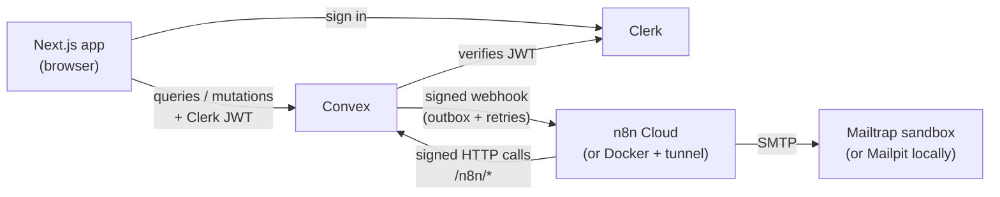

# LendLoop

> Borrow what you need. Lend what you don't.

A neighborhood tool-lending board. Neighbors list tools they can spare, request to borrow
each other's for a date range, and get notifications and overdue reminders from n8n.

**Stack:** Next.js 16 (App Router) · Clerk · Convex · n8n (n8n Cloud, or self-hosted with
Docker) · TypeScript · Tailwind + shadcn/ui · Mailtrap sandbox (or Mailpit locally) for email

## Implementation plan

The app is built in phases. Server-side rules come before the UI, and the Convex side of the
integration comes before n8n, so each layer builds on one that already enforces its rules.

1. **Foundation:** Next.js 16 (App Router), TypeScript, Tailwind + shadcn/ui, ESLint, Prettier,
   and CI that runs the typecheck, lint and format checks on every push.
2. **Authentication:** Clerk sign-in, the Convex client authenticated with the Clerk token, and
   `proxy.ts` redirecting signed-out visitors.
3. **Data model and access control:** the Convex schema, user roles, and the four privilege
   wrappers in `convex/lib/functions.ts`, with an ESLint rule that forbids the raw builders.
4. **Domain logic:** creating, editing and removing tools; loan requests; the loan state
   machine; overlap and availability rules (`convex/lib/loanRules.ts`).
5. **UI:** the public page, tool browsing, My listings, requests, and the admin pages.
6. **Integration layer (Convex side):** HMAC signing (`convex/lib/hmac.ts`), the transactional
   outbox (`convex/lib/notify.ts`), delivery with retries (`convex/webhooks.ts`), signed
   endpoints for n8n (`convex/http.ts`) and idempotent write-backs (`convex/automation.ts`).
7. **n8n workflows:** the three workflows (request notification, overdue reminders, error
   handler), exported to `n8n/workflows/`. They run on n8n Cloud, reading settings from n8n
   Variables, or self-hosted with Docker Compose (n8n, Postgres and Mailpit), reading them
   from `n8n/.env`.
8. **Refinement:** paginated lists with infinite scroll, stricter borrowing rules,
   Lending/Borrowing tabs, redesigned cards and admin tables, and the per-loan automation
   activity (bonus).

All of these are done; see [Features](#features).

**Verification**

- The borrow → approve → return cycle. Approving your own loan returns "not found", approving
  a returned loan is rejected, and a non-admin calling an admin function gets "forbidden".
- All five notification types (request, approve, decline, cancel, return) reach the inbox. One
  delivery failed while n8n was misconfigured and went through on Convex's automatic retry.
- On n8n Cloud, the notification webhook rejects an unsigned request with 401.
- The overdue reminder workflow sends one email per overdue loan. Running it again the same day
  sends nothing and writes no duplicate record.
- Signed endpoints: a valid signature gets 200. A bad, stale or missing signature gets 401.
- `npm run typecheck`, `npm run lint` and `npm run format:check` pass.

## Notes for reviewers

### Test accounts

| Role  | Email                             | Password             |
| ----- | --------------------------------- | -------------------- |
| Admin | `ajaypatidar7722+admin@gmail.com` | `Ajay_Patidar_Admin` |
| User  | `ajaypatidar7722+user@gmail.com`  | `Ajay_Patidar_User`  |

These are test-only accounts. Sign in as one in a normal window and the other in a private
window to try both sides of a loan. They exist only in the author's Clerk instance.

### Running against the author's instance

`.env.example` already points at the author's Convex deployment and Clerk instance, and n8n
Cloud is already connected to them, so no Convex, Clerk or n8n setup is needed:

```bash
npm install
cp .env.example .env.local
# add CLERK_SECRET_KEY to .env.local (shared privately by the author, not in the repo)
npm run dev
```

Then open http://localhost:3000 and sign in with the test accounts above.

### What to try

The seeded tools belong to demo users who can't sign in, so nobody could approve a request
for one. Use the two test accounts with each other's tools instead:

1. **Admin:** on **My listings**, click **List a tool** and add one.
2. **User:** on **Tools**, find it, click **Request to borrow** and pick dates (from
   today, at most 30 days).
3. **Admin:** on **Requests → Lending**, click **Approve**. The loan card shows "You were
   notified of the request" and, a few seconds after approving, "Borrower notified of the
   approval".
4. **User:** on **Requests → Borrowing**, the card shows "Lender notified of the request" and
   "You were notified of the approval". If the dates include today, the tool shows as **On loan** on **Tools**.
5. **Admin:** click **Mark returned**. The tool is available again.
6. **Rules:** as the user, request a tool, then request it again while the first request is
   still pending: the second is refused. Dates that overlap an approved loan are refused too.
   The date picker blocks past dates and loans over 30 days, and the server checks them as
   well. Your own tools show "Listed by you" instead of a request button.
7. **Admin pages:** as the admin, open **Admin** to see the Loans, Listings and Users tables,
   remove a listing, and mark the user as a Trusted Lender (the badge then shows on their
   tools). As the user, open `/admin` directly: access is refused, and the server refuses the
   admin functions too.

### Automated emails

Emails go to the author's Mailtrap sandbox, which catches them and delivers nothing, so you
won't receive them. You can still see that each automation ran: every loan card shows what n8n
did, e.g. "Lender notified of the request" or "Overdue reminder sent", and failures in red.
To receive the emails yourself, see [Deployment](#deployment).

The **overdue reminder** can't be checked from the app. It runs once a day in the author's n8n,
which reviewers can't open, and the only overdue loan is a seeded one between demo users, so
no test account can see its loan card. The author has run it: see
[Verification](#implementation-plan). To try it yourself, run the stack with your own n8n
(see [Local setup](#local-setup)) and use **Execute workflow** on **LendLoop: Overdue
reminders**.

### Other notes

- The seeded users (Alice, Bob and Carol, `@lendloop.test`) exist only in Convex and can't sign
  in. The seed data fills the tool list and admin tables and provides the overdue loan.
- n8n gives workflows new IDs on import, so relink the error workflow afterwards (see
  [`n8n/README.md`](n8n/README.md)).

## Features

| Requirement                              | Where                                                                                                                                |
| ---------------------------------------- | ------------------------------------------------------------------------------------------------------------------------------------ |
| Public page with tagline and tool list   | `/`: name and category only, from `tools.listPublic`; "Sign in to lend or borrow" opens Clerk                                        |
| List, edit, remove your own tools        | `/listings` → `tools.create` / `update` / `remove`                                                                                   |
| Browse tools with availability, filter   | `/tools` → `tools.list` (Available / On loan, category filter, infinite scroll)                                                      |
| Request to borrow for a date range       | Date-range picker → `loans.request`                                                                                                  |
| Approve / decline / mark returned        | `/requests` Lending tab → `loans.approve` / `decline` / `markReturned` (owner only)                                                  |
| My listings, My requests, Incoming views | `/listings`, and `/requests` with **Lending** / **Borrowing** tabs, status filters, pending-count badges and infinite scroll         |
| Admin role                               | `/admin`: loans, listings and users tables (infinite scroll, filterable); remove any listing; toggle Trusted Lender                  |
| Request notification workflow            | `n8n/workflows/lendloop-request-notification.json`                                                                                   |
| Overdue reminder workflow                | `n8n/workflows/lendloop-overdue-reminders.json` (daily, writes status back)                                                          |
| Error workflow                           | `n8n/workflows/lendloop-error-handler.json`                                                                                          |
| **Bonus:** automation activity per loan  | Every loan card shows what the automation did, e.g. "Lender notified of the request" or "Overdue reminder sent", and failures in red |

Loan rules enforced on the server: no borrowing your own tool, no requests while the tool is on
loan (until it is marked returned), no past start dates, at most
30 days, no overlap with an approved loan (an overdue loan keeps the tool busy until it's
marked returned), one pending request per tool per borrower. Approving a request declines the
other pending requests for overlapping dates. Status changes follow a fixed state machine
(`pending → approved | declined | cancelled`, `approved → returned`); anything else is rejected.

## Architecture



- **Next.js** renders the UI only. Every read and write goes to Convex with the user's Clerk token.
- **Convex** holds all data and all rules: authentication, roles, ownership, the loan state
  machine, and the integration with n8n. `proxy.ts` (Next.js middleware) only redirects
  signed-out visitors; it is not relied on for security.
- **n8n** sends email and runs the daily schedule. It keeps no user records: it gets what it
  needs per message and reports outcomes back to Convex.
- **Email** goes to a test inbox, not to real people: a Mailtrap sandbox when n8n runs on
  n8n Cloud, or Mailpit in Docker when self-hosted.

### Request notification (Convex → n8n)

1. A loan mutation (request, approve, decline, cancel, return) changes the status **and** inserts
   a `webhookDeliveries` row in the same transaction (transactional outbox, `convex/lib/notify.ts`).
2. A scheduled action (`convex/webhooks.ts`) signs the stored JSON and POSTs it to the n8n
   webhook. On a non-2xx or timeout it retries after 1, 5 and 30 minutes, then marks the delivery `failed`.
3. n8n verifies the signature (401 otherwise), skips events it already emailed, emails the one
   recipient, and reports `sent` or `failed` to `POST /n8n/automation-events`. If the email
   fails it answers 502, so Convex's outbox retries.

### Overdue reminders (n8n → Convex)

1. Once a day, n8n calls `GET /n8n/overdue-loans` (signed). Convex returns approved loans
   with `endDate < today (UTC)` that haven't had a successful reminder today, each with an
   idempotency key `reminder:<loanId>:<date>`.
2. n8n emails each borrower, then writes the outcome to `POST /n8n/reminders` with that key.
3. Running the workflow again the same day sends nothing: those loans are no longer returned.

### Failures

Every HTTP and email node in n8n retries 3 times. Anything still failing triggers the error
workflow, which emails the admin and records it via `POST /n8n/workflow-errors`.
Failed notifications and reminders also appear on the loan itself (bonus feature).

## Local setup

**Prerequisites:** Node.js 22.18+ (the test script runs TypeScript directly), a Clerk account
and a Convex account. For n8n, either an n8n Cloud account (Variables may need a paid plan)
and a free Mailtrap account, or Docker Desktop and ngrok (or any tunnel) to self-host.

### 1. App, Clerk and Convex

```bash
npm install
cp .env.example .env.local
```

1. In the [Clerk dashboard](https://dashboard.clerk.com), create an application and activate the
   **Convex** integration (see [Convex's Clerk guide](https://docs.convex.dev/auth/clerk)).
   Put the publishable and secret keys in `.env.local`, replacing the author's values copied
   from `.env.example`, and clear `NEXT_PUBLIC_CONVEX_URL` (step 3 fills it in).
2. In Clerk, **Configure → Sessions → Customize session token**, set the claims to:
   ```json
   {
     "name": "{{user.full_name}}",
     "email": "{{user.primary_email_address}}",
     "given_name": "{{user.first_name}}"
   }
   ```
3. Start Convex. The first run creates a dev deployment and writes its URL to `.env.local`:
   ```bash
   npx convex dev
   ```
4. The first push stops with an error that `CLERK_JWT_ISSUER_DOMAIN` isn't set; that's
   expected. In another terminal, tell Convex which Clerk instance to trust (your Clerk
   Frontend API URL), then restart `npx convex dev` if it doesn't pick it up on its own:
   ```bash
   npx convex env set CLERK_JWT_ISSUER_DOMAIN https://<your-instance>.clerk.accounts.dev
   ```
5. Run the app and sign in once at http://localhost:3000:
   ```bash
   npm run dev
   ```
6. Make yourself admin and add demo data (Alice, Bob and Carol, with tools and loans,
   including one overdue loan):
   ```bash
   npx convex run users:setRole '{"email":"you@example.com","role":"admin"}'
   npx convex run seed:demo
   ```

### 2. Shared secrets

Convex and n8n share two HMAC secrets, one per direction. Keep them in `n8n/.env` (gitignored)
so the test script below can use them too:

```bash
cp n8n/.env.example n8n/.env
```

Fill in `CONVEX_SITE_URL` (your deployment's `https://<name>.convex.site` URL; note `.site`) and
`LENDLOOP_OUTBOUND_SECRET` / `LENDLOOP_INBOUND_SECRET` (`openssl rand -hex 32` for each). Then
give Convex the same secrets, copied from the file so they stay out of your shell history:

```bash
npx convex env set LENDLOOP_OUTBOUND_SECRET "$(grep ^LENDLOOP_OUTBOUND_SECRET= n8n/.env | cut -d= -f2-)"
npx convex env set LENDLOOP_INBOUND_SECRET  "$(grep ^LENDLOOP_INBOUND_SECRET= n8n/.env | cut -d= -f2-)"
```

### 3a. n8n on n8n Cloud

1. In n8n Cloud, open **Overview → Variables** and add `CONVEX_SITE_URL`,
   `LENDLOOP_OUTBOUND_SECRET`, `LENDLOOP_INBOUND_SECRET` (the values from `n8n/.env`),
   `LENDLOOP_APP_URL` (`http://localhost:3000`) and `LENDLOOP_ALERT_EMAIL`.
2. In Mailtrap, open **Sandboxes → My Sandbox → SMTP** and create an **SMTP** credential in
   n8n with that host, port, username and password.
3. Import the three workflows, select the SMTP credential on each email node, link the error
   workflow and publish. Step-by-step:
   [`n8n/README.md`](n8n/README.md#on-n8n-cloud).
4. Point Convex at the notification webhook. No tunnel is needed:
   ```bash
   npx convex env set N8N_NOTIFY_WEBHOOK_URL "https://<your-instance>.app.n8n.cloud/webhook/lendloop/loan-events"
   ```

### 3b. n8n self-hosted (Docker, with Mailpit)

1. Convex runs in the cloud and can't reach `localhost`, so expose n8n through a tunnel and put
   the URL in `n8n/.env` as `N8N_WEBHOOK_URL=https://<your-tunnel-domain>/`. Also fill in
   `DB_POSTGRESDB_PASSWORD` and `N8N_ENCRYPTION_KEY`.
   ```bash
   ngrok http 5678
   ```
2. Start the stack: n8n on http://localhost:5678, Mailpit on http://localhost:8025.
   ```bash
   npm run infra:up
   ```
3. Import the workflows, create the Mailpit SMTP credential, link the error workflow and
   publish. Step-by-step: [`n8n/README.md`](n8n/README.md#self-hosted-docker).
4. Point Convex at the notification webhook:
   ```bash
   npx convex env set N8N_NOTIFY_WEBHOOK_URL "https://<your-tunnel-domain>/webhook/lendloop/loan-events"
   ```

### 4. Try it

- Request a tool as one user. The owner's email appears in the inbox (Mailtrap or Mailpit)
  within seconds, and the loan card shows "Lender notified of the request".
- In n8n, open **LendLoop: Overdue reminders** → **Execute workflow**. Bob gets a reminder; run it
  again and nothing new is sent.
- Call the Convex endpoints exactly as n8n does, signed with the secret from `n8n/.env`:
  ```bash
  node scripts/sign-and-send.mts GET /n8n/overdue-loans                  # 200
  node scripts/sign-and-send.mts GET /n8n/overdue-loans --bad-signature  # 401
  node scripts/sign-and-send.mts GET /n8n/overdue-loans --stale          # 401
  ```

Checks: `npm run typecheck`, `npm run lint`, `npm run format:check` (also run in CI on every push).

## Deployment

### Quick deploy for review

The simplest way to give reviewers a URL is to deploy only the Next.js app (e.g. on Vercel)
and keep everything else as it is: the Convex dev deployment, the Clerk dev instance and n8n
Cloud. On the host, set the values from `.env.example` (`NEXT_PUBLIC_CONVEX_URL`,
`NEXT_PUBLIC_CLERK_PUBLISHABLE_KEY` and the `NEXT_PUBLIC_CLERK_*` routes) plus
`CLERK_SECRET_KEY`, and use the default build command (`npm run build`). The test accounts
and admin role work as they are, and Clerk shows a small "Development mode" badge.

Keep the Convex code pushed (`npx convex dev` once after any change) and the n8n workflows
published while the review is running.

### Full production deploy

1. **Clerk:** create a production instance. Clerk needs a domain you own for this, not a
   `*.vercel.app` address. Set the same session-token claims as in
   [setup](#1-app-clerk-and-convex).
2. **Convex env:** set the production deployment's variables before the first deploy, since
   the auth config needs `CLERK_JWT_ISSUER_DOMAIN` (the production Clerk instance's issuer):
   ```bash
   npx convex env set --prod CLERK_JWT_ISSUER_DOMAIN "https://clerk.<your-domain>"
   npx convex env set --prod N8N_NOTIFY_WEBHOOK_URL "https://<your-instance>.app.n8n.cloud/webhook/lendloop/loan-events"
   ```
   and both secrets, the same way as in [Shared secrets](#2-shared-secrets) with `--prod`.
3. **Next.js** (e.g. on Vercel): set the production Clerk keys, the `NEXT_PUBLIC_CLERK_*`
   routes from `.env.example`, and a `CONVEX_DEPLOY_KEY` for the production deployment. The
   build command `npx convex deploy --cmd 'npm run build'` deploys the Convex functions,
   sets `NEXT_PUBLIC_CONVEX_URL` and builds the app.
4. **n8n Variables:** set `CONVEX_SITE_URL` to the production `https://<name>.convex.site`
   and `LENDLOOP_APP_URL` to the deployed app's URL, so links in emails work.
5. **Accounts:** production Clerk has no users yet. Create the test accounts there, sign in
   once with each, then make the admin:
   `npx convex run --prod users:setRole '{"email":"…","role":"admin"}'`. Add demo data with
   `npx convex run --prod seed:demo` if you want it.

### Email: what to change

Out of the box, every email lands in a Mailtrap **sandbox**: nothing reaches real inboxes.
Pick one of these after deploying.

**To read the emails in your own test inbox** (nothing sent to real people):

1. Create a free Mailtrap account and open **Sandboxes → My Sandbox → SMTP**.
2. In n8n, edit the SMTP credential and replace the host, port, username and password with
   yours. Nothing else changes.

**To deliver emails to real users:**

1. **Verify a domain.** In Mailtrap **Email Sending → Sending Domains**, add a domain you own
   and add the DNS records it shows (SPF, DKIM). Any provider with SMTP works instead (Postmark,
   SES, Gmail with an app password).
2. **Switch the SMTP credential** in n8n to the sending host and credentials Mailtrap shows for
   that domain (`live.smtp.mailtrap.io`), instead of the sandbox ones.
3. **Change the sender address.** The three email nodes (Send notification email, Send reminder
   email, Email admin) send from `LendLoop <notifications@lendloop.local>`. Set **From Email**
   in each to an address on the verified domain, then re-export the workflows (see
   [`n8n/README.md`](n8n/README.md#re-exporting-after-edits)).
4. **Update n8n Variables:** `LENDLOOP_APP_URL` to the deployed app's URL and
   `LENDLOOP_ALERT_EMAIL` to a real inbox for error alerts.
5. **Check:** request a tool with an account that has a real email address. The lender should
   receive the email, and the loan card shows "Lender notified of the request". The seeded
   `@lendloop.test` users can't receive email; messages to them bounce.

## Environment variables

No secret is in the repo. `.env*` files are gitignored except the two `.env.example` templates.

| Where                             | Variable                                                                       | Purpose                                                            |
| --------------------------------- | ------------------------------------------------------------------------------ | ------------------------------------------------------------------ |
| `.env.local` (Next.js)            | `NEXT_PUBLIC_CONVEX_URL`, `CONVEX_DEPLOYMENT`                                  | Which Convex deployment the app talks to (written by `convex dev`) |
| `.env.local` (Next.js)            | `NEXT_PUBLIC_CLERK_PUBLISHABLE_KEY`, `CLERK_SECRET_KEY`                        | Clerk sign-in                                                      |
| Convex env (`npx convex env set`) | `CLERK_JWT_ISSUER_DOMAIN`                                                      | Convex verifies Clerk tokens against this issuer                   |
| Convex env                        | `LENDLOOP_OUTBOUND_SECRET`                                                     | Convex signs webhooks to n8n                                       |
| Convex env                        | `LENDLOOP_INBOUND_SECRET`                                                      | Convex verifies calls from n8n                                     |
| Convex env                        | `N8N_NOTIFY_WEBHOOK_URL`                                                       | The n8n webhook (n8n Cloud URL, or tunnel URL + webhook path)      |
| `n8n/.env`                        | `LENDLOOP_OUTBOUND_SECRET`, `LENDLOOP_INBOUND_SECRET`                          | Same values as in Convex; also used by the test script             |
| `n8n/.env`                        | `CONVEX_SITE_URL`                                                              | Convex HTTP endpoint base                                          |
| `n8n/.env` (Docker only)          | `DB_POSTGRESDB_PASSWORD`, `N8N_ENCRYPTION_KEY`                                 | n8n's database and credential encryption                           |
| `n8n/.env` (Docker only)          | `N8N_WEBHOOK_URL`                                                              | n8n's public webhook base (the tunnel)                             |
| `n8n/.env` (optional)             | `LENDLOOP_APP_URL`, `LENDLOOP_ALERT_EMAIL`                                     | Links in emails; where error alerts go                             |
| n8n Variables (n8n Cloud)         | The two secrets, `CONVEX_SITE_URL`, `LENDLOOP_APP_URL`, `LENDLOOP_ALERT_EMAIL` | n8n Cloud blocks `$env`, so the workflows read these instead       |

The Convex variables are declared with validators in `convex/convex.config.ts` and read through
a typed `env` object.

## Security decisions

- **Authorization lives in Convex, not the UI.** Every public function is built with one of
  four wrappers in `convex/lib/functions.ts`: `publicQuery`, `authedQuery/Mutation`,
  `adminQuery/Mutation`. An ESLint rule forbids the raw builders elsewhere, so every endpoint
  declares its privilege level where it is defined. Hiding the Admin link is cosmetic.
- **Identity comes from the verified Clerk token only.** No function accepts "who am I" as an
  argument; IDs in arguments are always targets, checked with `assertToolOwner` and
  `assertLoanParty`. The owner of a new tool is always the caller.
- **Roles are stored in Convex.** New users are `user`. The only way to grant `admin` is
  `users:setRole`, an internal function run from the CLI; no client can call it.
- **No probing.** Someone who isn't a party to a loan gets "not found", not "forbidden", so
  loan IDs can't be tested for existence. Error messages are generic and coded.
- **Every argument is validated**, plus server-side checks validators can't express (date
  formats, ranges, text lengths).
- **Signed integration in both directions.** HMAC-SHA256 over `timestamp.rawBody`, headers
  `X-LendLoop-Timestamp` and `X-LendLoop-Signature`, constant-time comparison, a 5-minute
  window against replays, a 16 KB body limit. **Separate secrets per direction**, so a leak in
  one direction can't be used to forge the other.
- **Secrets only in env.** Convex env vars, n8n Variables on n8n Cloud, or `n8n/.env` when
  self-hosted. The workflows read them at runtime, and the exported JSON contains no secret
  values. Self-hosted, n8n's Code nodes may only load Node's `crypto` module, and n8n listens
  on localhost only, with webhooks going through the tunnel.

## Data minimization

- **Public page:** tool name and category only. No owners, descriptions or availability.
- **Signed-in users** see other people by **first name** only (plus the Trusted Lender badge),
  never their email or surname. Display names never fall back to the email address: without a
  name in Clerk, the app shows "Neighbor".
- **Webhook to n8n:** one recipient's first name and email, the other party's first name, tool
  name, dates and status. No user IDs, descriptions or other loans.
- **Overdue loans endpoint:** only what a reminder needs (borrower first name and email, tool
  name, due date, days overdue).
- **Loan activity shown in the app:** kind, outcome and time only; error details stay server-side.
- **n8n** stores no user records. Its execution logs contain recipient emails: self-hosted,
  they are pruned after 7 days and telemetry is off; on n8n Cloud, retention follows the
  plan. Demo users use the reserved `.test` domain.

## Reliability and idempotency

| Risk                                       | Handling                                                                                                                   |
| ------------------------------------------ | -------------------------------------------------------------------------------------------------------------------------- |
| Notification lost if n8n is down           | Outbox row committed with the status change; retries after 1, 5 and 30 minutes; then `failed`, shown on the loan           |
| Notification sent for a rolled-back change | Impossible: the outbox row is in the same transaction                                                                      |
| Duplicate email on a retry                 | `eventId = loanId:type`, unique because each transition happens at most once; n8n remembers emailed eventIds               |
| Duplicate reminder                         | Convex leaves out loans already reminded today; write-backs upsert on `reminder:<loanId>:<date>`                           |
| Duplicate write-back records               | Every write-back upserts on a unique key; a later `sent` can replace `failed`, never the reverse                           |
| A workflow fails silently                  | Retries on every HTTP and email node, then the error workflow emails the admin and records it in Convex (`workflowErrors`) |
| Actions aren't transactional               | Actions only do I/O; every state change is a small internal mutation                                                       |

## Project structure

```
app/                 Pages: public home, (app)/ route group for signed-in pages, admin/
components/          UI components (shadcn/ui in components/ui)
convex/
  lib/functions.ts   The four privilege wrappers (the RBAC choke point)
  lib/auth.ts        Identity, role and ownership guards
  lib/loanRules.ts   State machine, overlap and availability rules
  lib/notify.ts      Transactional outbox (what gets sent to n8n)
  lib/hmac.ts        Signing and verification
  lib/views.ts       Minimal shapes returned to the UI, incl. loan activity
  tools.ts loans.ts admin.ts users.ts   Public functions
  webhooks.ts        Delivery action with retries
  http.ts            Signed endpoints for n8n
  automation.ts      Overdue lookup and idempotent write-backs
  seed.ts            Demo data (internal)
n8n/                 docker-compose.yml, .env.example, workflows/*.json
scripts/             sign-and-send.mts (manual endpoint testing)
```

## What I'd change for production

- **Secrets:** a managed secret store, per-environment keys, and rotation without downtime
  (accept the current and previous secret during a rollover).
- **n8n:** queue mode with workers, backups, TLS, SSO in front of the editor, and a stable
  private network or allow-listed ingress instead of a tunnel.
- **Email:** a real provider (e.g. Postmark or SES) with SPF/DKIM, bounce handling, and
  per-user notification preferences and unsubscribe.
- **Reliability:** alerting (Sentry, PagerDuty) on failed deliveries and workflow errors, an
  admin page to view and replay failed deliveries, a sweeper cron for deliveries stuck in
  `pending`, and a check that the daily workflow actually ran. Store emailed eventIds in a
  durable table instead of n8n workflow static data.
- **Security:** rate limits on loan requests and HTTP endpoints, CSP headers, an audit log for
  role changes and admin removals, and moving page-level auth checks into each page as Clerk
  now recommends instead of path matching in `proxy.ts`.
- **Data:** retention policies for `automationEvents` and `webhookDeliveries`, account deletion
  and export, and timezone-aware due dates (today "overdue" means after the end date in UTC).
- **Scale:** every list is cursor-paginated, but the nav badge counts are bounded
  reads capped at 99; `@convex-dev/aggregate` counters would give exact totals.
- **Ops and testing:** separate dev, staging and prod deployments; workflows promoted through
  CI; automated tests with `convex-test`.

## Trade-offs

- **n8n de-duplicates emails using workflow static data**, which only persists for published
  workflows, not manual test runs. Convex-side idempotency still prevents duplicate records.
- **Email goes to a test inbox (Mailtrap sandbox or Mailpit).** No real person gets an email,
  which makes the demo safe, but it's not real delivery.
- **n8n Variables are plain text** to anyone with access to the n8n Cloud instance, unlike
  credentials, which are encrypted. They're used because Code nodes can't read credentials,
  and the HMAC signing happens in Code nodes.
- **Self-hosted only: the tunnel URL** must be updated in Convex whenever it changes (a static
  ngrok domain avoids this).
