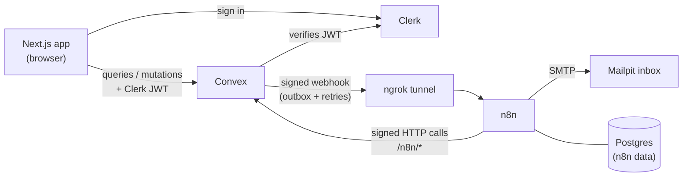

# LendLoop

> Borrow what you need. Lend what you don't.

A neighborhood tool-lending board. Neighbors list tools they can spare, request to borrow
each other's for a date range, and get notifications and overdue reminders from n8n.

**Stack:** Next.js 16 (App Router) · Clerk · Convex · n8n (self-hosted, Docker) · TypeScript ·
Tailwind + shadcn/ui · Mailpit (local inbox)

## Features

| Requirement                              | Where                                                                                                                                    |
| ---------------------------------------- | ---------------------------------------------------------------------------------------------------------------------------------------- |
| Public page with tagline and tool list   | `/`: name and category only, from `tools.listPublic`; "Sign in to lend or borrow" opens Clerk                                            |
| List, edit, remove your own tools        | `/listings` → `tools.create` / `update` / `remove`                                                                                       |
| Browse tools with availability, filter   | `/tools` → `tools.list` (Available / On loan, category filter, infinite scroll)                                                          |
| Request to borrow for a date range       | Date-range picker → `loans.request`                                                                                                      |
| Approve / decline / mark returned        | `/requests` Lending tab → `loans.approve` / `decline` / `markReturned` (owner only)                                                      |
| My listings, My requests, Incoming views | `/listings`, and `/requests` with **Lending** / **Borrowing** tabs, status filters, pending-count badges and infinite scroll             |
| Admin role                               | `/admin`: loans, listings and users tables (infinite scroll, filterable); remove any listing; toggle Trusted Lender                      |
| Request notification workflow            | `n8n/workflows/lendloop-request-notification.json`                                                                                       |
| Overdue reminder workflow                | `n8n/workflows/lendloop-overdue-reminders.json` (daily, writes status back)                                                              |
| Error workflow                           | `n8n/workflows/lendloop-error-handler.json`                                                                                              |
| **Bonus:** automation activity per loan  | Every loan card shows e.g. "Lender notified of the request · 5 minutes ago" or "Overdue reminder sent · 2 days ago", and failures in red |

Loan rules enforced on the server: no borrowing your own tool, no requests while the tool is on
loan (until it is marked returned), no past start dates, at most
30 days, no overlap with an approved loan (an overdue loan keeps the tool busy until it's
marked returned), one pending request per tool per borrower. Approving a request declines the
other pending requests for overlapping dates. Status changes follow a fixed state machine
(`pending → approved | declined | cancelled`, `approved → returned`); anything else is rejected.

## Architecture



- **Next.js** renders the UI only. Every read and write goes to Convex with the user's Clerk token.
- **Convex** holds all data and all rules: authentication, roles, ownership, the loan state
  machine, and the integration with n8n. `proxy.ts` (Next.js middleware) only redirects
  signed-out visitors; it is not relied on for security.
- **n8n** sends email and runs the daily schedule. It keeps no user records: it gets what it
  needs per message and reports outcomes back to Convex.

### Request notification (Convex → n8n)

1. A loan mutation (request, approve, decline, cancel, return) changes the status **and** inserts
   a `webhookDeliveries` row in the same transaction (transactional outbox, `convex/lib/notify.ts`).
2. A scheduled action (`convex/webhooks.ts`) signs the stored JSON and POSTs it to the n8n
   webhook. On a non-2xx or timeout it retries after 1, 5 and 30 minutes, then marks the delivery `failed`.
3. n8n verifies the signature (401 otherwise), skips events it already emailed, emails the one
   recipient, and reports `sent` or `failed` to `POST /n8n/automation-events`. If the email
   fails it answers 502, so Convex's outbox retries.

### Overdue reminders (n8n → Convex)

1. Daily at 09:00 UTC, n8n calls `GET /n8n/overdue-loans` (signed). Convex returns approved loans
   with `endDate < today (UTC)` that haven't had a successful reminder today, each with an
   idempotency key `reminder:<loanId>:<date>`.
2. n8n emails each borrower, then writes the outcome to `POST /n8n/reminders` with that key.
3. Running the workflow again the same day sends nothing: those loans are no longer returned.

### Failures

Every HTTP and email node in n8n retries 3 times. Anything still failing triggers the error
workflow, which emails the admin (Mailpit) and records it via `POST /n8n/workflow-errors`.
Failed notifications and reminders also appear on the loan itself (bonus feature).

## Local setup

**Prerequisites:** Node.js 22.18+ (the test script runs TypeScript directly), Docker Desktop,
a Clerk account, a Convex account, and ngrok (or any tunnel).

### 1. App, Clerk and Convex

```bash
npm install
cp .env.example .env.local
```

1. In the [Clerk dashboard](https://dashboard.clerk.com), create an application and activate the
   **Convex** integration (see [Convex's Clerk guide](https://docs.convex.dev/auth/clerk)).
   Put the publishable and secret keys in `.env.local`.
2. In Clerk, **Configure → Sessions → Customize session token**, set the claims to:
   ```json
   {
     "name": "{{user.full_name}}",
     "email": "{{user.primary_email_address}}",
     "given_name": "{{user.first_name}}"
   }
   ```
3. Start Convex. The first run creates a dev deployment and writes its URL to `.env.local`:
   ```bash
   npx convex dev
   ```
4. In another terminal, tell Convex which Clerk instance to trust (your Clerk Frontend API URL):
   ```bash
   npx convex env set CLERK_JWT_ISSUER_DOMAIN https://<your-instance>.clerk.accounts.dev
   ```
5. Run the app and sign in once at http://localhost:3000:
   ```bash
   npm run dev
   ```
6. Make yourself admin and add demo data (Alice, Bob and Carol, with tools and loans,
   including one overdue loan):
   ```bash
   npx convex run users:setRole '{"email":"you@example.com","role":"admin"}'
   npx convex run seed:demo
   ```

### 2. n8n, Postgres and Mailpit

1. Create `n8n/.env` and generate secrets (`openssl rand -hex 32` for each):
   ```bash
   cp n8n/.env.example n8n/.env
   ```
   Set `CONVEX_SITE_URL` to your deployment's `https://<name>.convex.site` URL (note `.site`).
2. Convex runs in the cloud and can't reach `localhost`, so expose n8n through a tunnel and put
   the URL in `n8n/.env` as `N8N_WEBHOOK_URL=https://<your-tunnel-domain>/`:
   ```bash
   ngrok http 5678
   ```
3. Start the stack: n8n on http://localhost:5678, Mailpit on http://localhost:8025.
   ```bash
   npm run infra:up
   ```
4. Give Convex the same two shared secrets (copied from the file, so they stay out of your shell history):
   ```bash
   npx convex env set LENDLOOP_OUTBOUND_SECRET "$(grep ^LENDLOOP_OUTBOUND_SECRET= n8n/.env | cut -d= -f2-)"
   npx convex env set LENDLOOP_INBOUND_SECRET  "$(grep ^LENDLOOP_INBOUND_SECRET= n8n/.env | cut -d= -f2-)"
   ```
5. Import the workflows, create the Mailpit SMTP credential, link the error workflow and
   publish. Step-by-step: [`n8n/README.md`](n8n/README.md).
6. Point Convex at the notification webhook:
   ```bash
   npx convex env set N8N_NOTIFY_WEBHOOK_URL "https://<your-tunnel-domain>/webhook/lendloop/loan-events"
   ```

### 3. Try it

- Request a tool as one user. The owner's email appears in Mailpit within seconds, and the loan
  card shows "Lender notified of the request".
- In n8n, open **LendLoop: Overdue reminders** → **Execute workflow**. Bob gets a reminder; run it
  again and nothing new is sent.
- Call the Convex endpoints exactly as n8n does, signed with the secret from `n8n/.env`:
  ```bash
  node scripts/sign-and-send.mts GET /n8n/overdue-loans                  # 200
  node scripts/sign-and-send.mts GET /n8n/overdue-loans --bad-signature  # 401
  node scripts/sign-and-send.mts GET /n8n/overdue-loans --stale          # 401
  ```

Checks: `npm run typecheck`, `npm run lint`, `npm run format:check` (also run in CI on every push).

## Environment variables

No secret is in the repo. `.env*` files are gitignored except the two `.env.example` templates.

| Where                             | Variable                                                | Purpose                                                            |
| --------------------------------- | ------------------------------------------------------- | ------------------------------------------------------------------ |
| `.env.local` (Next.js)            | `NEXT_PUBLIC_CONVEX_URL`, `CONVEX_DEPLOYMENT`           | Which Convex deployment the app talks to (written by `convex dev`) |
| `.env.local` (Next.js)            | `NEXT_PUBLIC_CLERK_PUBLISHABLE_KEY`, `CLERK_SECRET_KEY` | Clerk sign-in                                                      |
| Convex env (`npx convex env set`) | `CLERK_JWT_ISSUER_DOMAIN`                               | Convex verifies Clerk tokens against this issuer                   |
| Convex env                        | `LENDLOOP_OUTBOUND_SECRET`                              | Convex signs webhooks to n8n                                       |
| Convex env                        | `LENDLOOP_INBOUND_SECRET`                               | Convex verifies calls from n8n                                     |
| Convex env                        | `N8N_NOTIFY_WEBHOOK_URL`                                | Where notifications are sent (tunnel URL + webhook path)           |
| `n8n/.env` (Docker Compose)       | `DB_POSTGRESDB_PASSWORD`, `N8N_ENCRYPTION_KEY`          | n8n's database and credential encryption                           |
| `n8n/.env`                        | `LENDLOOP_OUTBOUND_SECRET`, `LENDLOOP_INBOUND_SECRET`   | Same values as in Convex                                           |
| `n8n/.env`                        | `CONVEX_SITE_URL`, `N8N_WEBHOOK_URL`                    | Convex HTTP endpoint base; n8n's public webhook base               |
| `n8n/.env` (optional)             | `LENDLOOP_APP_URL`, `LENDLOOP_ALERT_EMAIL`              | Links in emails; where error alerts go                             |

The Convex variables are declared with validators in `convex/convex.config.ts` and read through
a typed `env` object.

## Security decisions

- **Authorization lives in Convex, not the UI.** Every public function is built with one of
  four wrappers in `convex/lib/functions.ts`: `publicQuery`, `authedQuery/Mutation`,
  `adminQuery/Mutation`. An ESLint rule forbids the raw builders elsewhere, so every endpoint
  declares its privilege level where it is defined. Hiding the Admin link is cosmetic.
- **Identity comes from the verified Clerk token only.** No function accepts "who am I" as an
  argument; IDs in arguments are always targets, checked with `assertToolOwner` and
  `assertLoanParty`. The owner of a new tool is always the caller.
- **Roles are stored in Convex.** New users are `user`. The only way to grant `admin` is
  `users:setRole`, an internal function run from the CLI; no client can call it.
- **No probing.** Someone who isn't a party to a loan gets "not found", not "forbidden", so
  loan IDs can't be tested for existence. Error messages are generic and coded.
- **Every argument is validated**, plus server-side checks validators can't express (date
  formats, ranges, text lengths).
- **Signed integration in both directions.** HMAC-SHA256 over `timestamp.rawBody`, headers
  `X-LendLoop-Timestamp` and `X-LendLoop-Signature`, constant-time comparison, a 5-minute
  window against replays, a 16 KB body limit. **Separate secrets per direction**, so a leak in
  one direction can't be used to forge the other.
- **Secrets only in env.** Convex env vars and `n8n/.env`; the workflows read them with
  `$env.*`, and the exported JSON contains no secret values. n8n's Code nodes may only load
  Node's `crypto` module. n8n listens on localhost only; webhooks go through the tunnel.

## Data minimization

- **Public page:** tool name and category only. No owners, descriptions or availability.
- **Signed-in users** see other people by **first name** only (plus the Trusted Lender badge),
  never their email or surname. Display names never fall back to the email address: without a
  name in Clerk, the app shows "Neighbor".
- **Webhook to n8n:** one recipient's first name and email, the other party's first name, tool
  name, dates and status. No user IDs, descriptions or other loans.
- **Overdue loans endpoint:** only what a reminder needs (borrower first name and email, tool
  name, due date, days overdue).
- **Loan activity shown in the app:** kind, outcome and time only; error details stay server-side.
- **n8n** stores no user records, and its execution logs (which contain recipient emails) are
  pruned after 7 days. Telemetry is off. Demo users use the reserved `.test` domain.

## Reliability and idempotency

| Risk                                       | Handling                                                                                                                   |
| ------------------------------------------ | -------------------------------------------------------------------------------------------------------------------------- |
| Notification lost if n8n is down           | Outbox row committed with the status change; retries after 1, 5 and 30 minutes; then `failed`, shown on the loan           |
| Notification sent for a rolled-back change | Impossible: the outbox row is in the same transaction                                                                      |
| Duplicate email on a retry                 | `eventId = loanId:type`, unique because each transition happens at most once; n8n remembers emailed eventIds               |
| Duplicate reminder                         | Convex leaves out loans already reminded today; write-backs upsert on `reminder:<loanId>:<date>`                           |
| Duplicate write-back records               | Every write-back upserts on a unique key; a later `sent` can replace `failed`, never the reverse                           |
| A workflow fails silently                  | Retries on every HTTP and email node, then the error workflow emails the admin and records it in Convex (`workflowErrors`) |
| Actions aren't transactional               | Actions only do I/O; every state change is a small internal mutation                                                       |

## Project structure

```
app/                 Pages: public home, (app)/ route group for signed-in pages, admin/
components/          UI components (shadcn/ui in components/ui)
convex/
  lib/functions.ts   The four privilege wrappers (the RBAC choke point)
  lib/auth.ts        Identity, role and ownership guards
  lib/loanRules.ts   State machine, overlap and availability rules
  lib/notify.ts      Transactional outbox (what gets sent to n8n)
  lib/hmac.ts        Signing and verification
  lib/views.ts       Minimal shapes returned to the UI, incl. loan activity
  tools.ts loans.ts admin.ts users.ts   Public functions
  webhooks.ts        Delivery action with retries
  http.ts            Signed endpoints for n8n
  automation.ts      Overdue lookup and idempotent write-backs
  seed.ts            Demo data (internal)
n8n/                 docker-compose.yml, .env.example, workflows/*.json
scripts/             sign-and-send.mts (manual endpoint testing)
```

## What I'd change for production

- **Secrets:** a managed secret store, per-environment keys, and rotation without downtime
  (accept the current and previous secret during a rollover).
- **n8n:** queue mode with workers, backups, TLS, SSO in front of the editor, and a stable
  private network or allow-listed ingress instead of a tunnel.
- **Email:** a real provider (e.g. Postmark or SES) with SPF/DKIM, bounce handling, and
  per-user notification preferences and unsubscribe.
- **Reliability:** alerting (Sentry, PagerDuty) on failed deliveries and workflow errors, an
  admin page to view and replay failed deliveries, a sweeper cron for deliveries stuck in
  `pending`, and a check that the daily workflow actually ran. Store emailed eventIds in a
  durable table instead of n8n workflow static data.
- **Security:** rate limits on loan requests and HTTP endpoints, CSP headers, an audit log for
  role changes and admin removals, and moving page-level auth checks into each page as Clerk
  now recommends instead of path matching in `proxy.ts`.
- **Data:** retention policies for `automationEvents` and `webhookDeliveries`, account deletion
  and export, and timezone-aware due dates (today "overdue" means after the end date in UTC).
- **Scale:** every list is cursor-paginated, but the nav badge counts are bounded
  reads capped at 99; `@convex-dev/aggregate` counters would give exact totals.
- **Ops and testing:** separate dev, staging and prod deployments; workflows promoted through
  CI; automated tests (below).

## Trade-offs and not done

- **No automated tests yet.** Verified manually: the RBAC paths, the state machine, both
  workflows end to end, duplicate runs, invalid/stale/missing signatures (401), and a real
  retry after n8n failed. Next would be `convex-test` covering an RBAC matrix, every state
  transition, overlap rules, HMAC cases and idempotency.
- **n8n de-duplicates emails using workflow static data**, which only persists for published
  workflows, not manual test runs. Convex-side idempotency still prevents duplicate records.
- **Email is local (Mailpit).** Nothing leaves your machine, which makes the demo safe, but
  it's not real delivery.
- **The tunnel URL** must be updated in Convex whenever it changes (a static ngrok domain avoids this).
